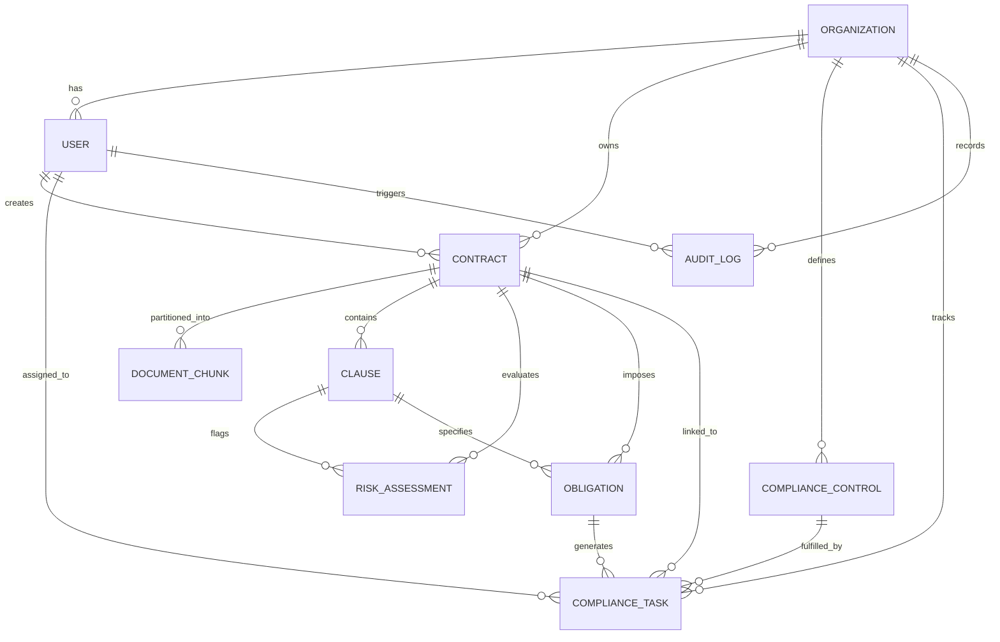

# LexFlow AI: System Architecture & Technical Project Report

**Project Name:** LexFlow AI  
**Repository:** `LexFlow AI`  
**Domain:** LegalTech, Contract Intelligence & Compliance Automation  
**Current Phase:** Backend Architecture, Data Modeling, Secure Authentication, Document Processing, Analysis Engine & Compliance Management (Milestones 1–6)  
**Author / Engineering Team:** LexFlow AI Backend Team  

---

## 1. Executive Summary

**LexFlow AI** is an enterprise-grade LegalTech platform designed to automate contract lifecycle management, extract obligations, detect legal and financial risks, and map contractual clauses directly to industry compliance frameworks (SOC 2, ISO 27001, GDPR, HIPAA).

This report documents the architectural design, engineering specifications, relational database schema, security model, and implementation details of the backend foundation built with **FastAPI**, **SQLAlchemy 2.0**, **SQLite 3.45.1**, **Alembic**, **PyMuPDF**, **python-docx**, **Argon2id/JWT authentication**, a **deterministic rule-based contract analysis engine**, and an **organization-scoped compliance management module**. The backend enforces strict multi-tenant isolation, cryptographically secures user credentials, provides automated audit logging, ingests and chunks legal documents (PDF and DOCX), detects 14 clause categories, evaluates 12 legal risk rules, extracts actionable obligations and deadlines, manages compliance controls and tasks with dynamic overdue tracking, and includes an automated test suite comprising **140 passed tests**.

---

## 2. Problem Statement & Objectives

Modern enterprise legal and compliance teams face severe bottlenecks:
- **High Review Latency**: Manual review of Master Services Agreements (MSAs), Non-Disclosure Agreements (NDAs), and vendor contracts requires hours of lawyer time per document.
- **Hidden Liabilities & Carve-outs**: Uncapped indemnification clauses, unfavorable liability caps, and non-standard governing laws frequently pass through unnoticed.
- **Missed Contractual Deadlines**: Deliverables, renewal notices, and audit compliance milestones are buried in dense legal text.
- **Strict Data Segregation Needs**: Legal documents are strictly confidential and subject to attorney-client privilege. Multi-tenant data leakage is impermissible.

### Key Technical Objectives
1. **Modular, High-Performance REST Backend**: Built on FastAPI with asynchronous capabilities, typed schemas (Pydantic v2), and self-documenting OpenAPI specs.
2. **Strict Multi-Tenancy by Design**: All domain models anchor to an `Organization` root entity. Tenant context is derived strictly from cryptographic tokens, never from client input.
3. **Robust Relational Data Model**: 10 interconnected domain entities supporting document chunking (for RAG), clauses, obligations, risk assessments, compliance frameworks, and audit logging.
4. **Defense-in-Depth Authentication & Password Security**: Argon2id password hashing (`pwdlib`), signed JWT bearer access tokens with embedded tenant claims, and role-based access control (RBAC).
5. **Secure Contract Ingestion & Document Processing**: Upload pipeline for PDF and DOCX files up to 15 MB, binary signature validation, anti-path traversal protection, and page/paragraph-preserving text chunking.
6. **Reproducible Database Migrations**: Version-controlled Alembic migrations configured with batch operations for SQLite compatibility.
7. **100% Automated Test Coverage for Critical Paths**: Rigorous unit, integration, and security tests validating schema consistency, foreign key enforcement, cascade deletions, upload limits, and authorization boundaries.

---

## 3. Technology Stack & Technical Rationale

| Layer | Component | Version | Rationale & Trade-offs |
| :--- | :--- | :--- | :--- |
| **Language** | Python | `3.11.9` | High runtime performance, built-in `StrEnum`, strict typing support via `typing.Annotated` and `typing.TYPE_CHECKING`. |
| **Framework** | FastAPI | `0.115+` | High throughput ASGI framework, automatic interactive Swagger UI / ReDoc generation, seamless dependency injection. |
| **ORM** | SQLAlchemy | `2.0+` | Industry standard declarative 2.0 syntax (`Mapped`, `mapped_column`), strong typing, explicit relationship declarations. |
| **Database** | SQLite | `3.45.1` | Zero-configuration, file-based ACID storage; configured with `check_same_thread=False` and enforced `PRAGMA foreign_keys=ON`. |
| **Migrations** | Alembic | `1.13+` | Programmatic schema migrations with `render_as_batch=True` to seamlessly support SQLite schema alterations. |
| **PDF Extraction** | PyMuPDF | `2.1` | High-speed, page-by-page text extraction with coordinate and page number retention; detects unreadable/scanned documents. |
| **DOCX Extraction**| python-docx | `1.2.0` | Native Word document parsing extracting paragraphs and table structures while preserving section references. |
| **Password Hashing** | pwdlib (Argon2id) | `0.2+` | Winner of the Password Hashing Competition; resistant to GPU/ASIC cracking and memory-hard attacks. |
| **Token Auth** | PyJWT | `2.8+` | Cryptographically signed HMAC-SHA256 stateless tokens with strict claim verification (`sub`, `org_id`, `exp`, `iat`, `nbf`). |
| **Testing** | Pytest & pytest-asyncio | `8.0+` | Fixture-based test suite with isolated transactional rollback and in-memory SQLite instances. |

---

## 4. System Architecture & Directory Structure

LexFlow AI follows a modular, domain-driven directory layout separating concerns between configuration, database persistence, domain models, Pydantic validation schemas, dependency injection, services, and API routing.

```
backend/
├── app/
│   ├── __init__.py                # Package initialization and version definition (0.1.0)
│   ├── main.py                    # FastAPI entrypoint, CORS middleware, GET / and GET /health
│   ├── core/
│   │   ├── __init__.py
│   │   ├── config.py              # Pydantic BaseSettings loading from .env & environment
│   │   └── security.py            # Argon2id hashing, password validation, and JWT token utilities
│   ├── db/
│   │   ├── __init__.py
│   │   ├── base.py                # SQLAlchemy 2.0 DeclarativeBase
│   │   └── session.py             # SQLite Engine (foreign keys pragma), SessionLocal, get_db()
│   ├── models/                    # Modular SQLAlchemy 2.0 domain models
│   │   ├── __init__.py            # Central registry exporting Base and all 10 models
│   │   ├── base.py                # UUIDMixin and TimestampMixin
│   │   ├── enums.py               # StrEnum domain definitions (UserRole, Statuses, Severities)
│   │   ├── organization.py        # Organization (Tenant Root)
│   │   ├── user.py                # User account with RBAC
│   │   ├── contract.py            # Contract agreement entity
│   │   ├── document_chunk.py      # Vector/RAG text chunks
│   │   ├── clause.py              # Extracted legal clauses
│   │   ├── risk_assessment.py     # Identified contract risks
│   │   ├── obligation.py          # Contractual obligations and milestones
│   │   ├── compliance.py          # ComplianceControl and ComplianceTask
│   │   └── audit_log.py           # Immutable audit log with JSON details
│   ├── schemas/                   # Pydantic v2 validation models
│   │   ├── __init__.py
│   │   ├── health.py              # HealthCheckResponse, RootResponse
│   │   ├── auth.py                # UserRegisterRequest, LoginRequest, TokenResponse, UserProfileResponse
│   │   └── contract.py            # ContractResponse, ContractDetailResponse, ContractListResponse
│   ├── services/                  # Document processing & business logic
│   │   ├── __init__.py
│   │   └── document_processor.py  # PyMuPDF & python-docx extraction, validation, chunking
│   ├── api/
│   │   ├── __init__.py
│   │   ├── deps.py                # Reusable security, JWT validation, and tenant-scoping dependencies
│   │   └── v1/
│   │       ├── __init__.py
│   │       ├── api.py             # Central APIRouter mounting /auth, /contracts, and /health
│   │       └── endpoints/
│   │           ├── __init__.py
│   │           ├── auth.py        # /register, /login, /me endpoints
│   │           ├── contracts.py   # /upload, list, get, and delete contract endpoints
│   │           └── health.py      # /health modular router
├── tests/
│   ├── __init__.py
│   ├── conftest.py                # Pytest fixtures (in-memory SQLite, connection listener, TestClient)
│   ├── test_db.py                 # SQLite engine configuration, session lifecycle tests (5 tests)
│   ├── test_health.py             # Root, health, API v1, and CORS tests (4 tests)
│   ├── test_migrations.py         # Programmatic Alembic upgrade & schema inspection tests (1 test)
│   ├── test_models.py             # 10 models, relationships, cascades, unique constraints (14 tests)
│   ├── test_auth.py               # Registration, login, JWT claims, expiry, tenant spoof protection (15 tests)
│   └── test_contracts.py          # PDF/DOCX upload, extraction, chunking, limits, delete, tenant isolation (14 tests)
├── alembic/                       # Alembic migration environment
│   ├── env.py                     # Configured with Base.metadata and SQLite batch alter support
│   ├── script.py.mako
│   └── versions/
│       └── 9b8d2a02d55b_create_initial_models.py # Initial baseline migration (all 10 tables)
├── alembic.ini                    # Alembic configuration file
├── pytest.ini                     # Pytest testpaths, warning filters, asyncio configuration
├── requirements.txt               # Locked backend dependencies
├── .env.example                   # Sanitized environment variable template
├── .env                           # Local development environment configuration
└── README.md                      # Quickstart guide and Swagger UI documentation
```

---

## 5. Relational Database Schema & Domain Modeling

All 10 domain entities leverage UUID primary keys (`uuid.UUID`), indexed foreign keys with explicit cascade behavior, and timezone-aware timestamps (`created_at`, `updated_at`).

### Entity-Relationship Diagram (ERD)



---

## 6. Document Ingestion, Processing & Chunking Architecture (Milestone 4)

### 1. Ingestion Security & Validation Pipeline
- **Upload Limit**: 15 MB max file size, configurable via `MAX_UPLOAD_SIZE_BYTES`.
- **Extension & MIME Validation**: Only `.pdf` and `.docx` files are accepted.
- **Magic Byte Verification**:
  - PDF: Verified by `%PDF` binary header and PyMuPDF document structure validation.
  - DOCX: Verified by `PK\x03\x04` ZIP binary header and validation of internal `word/document.xml`.
- **Anti-Path Traversal**: Filenames are completely replaced by UUID-based filenames (`uuid.uuid4().hex + ext`) stored in per-organization storage directories (`uploads/{org_id}/`). Original filenames are preserved safely in database metadata.
- **Safe API Outputs**: Internal filesystem paths (`file_path`) are never included in API responses.

### 2. PDF Text Extraction (PyMuPDF)
- Extracts text on a strict page-by-page basis.
- Preserves 1-indexed `page_number` for each chunk to maintain legal citation fidelity.
- Rejects empty or scanned PDFs without embedded OCR text layers, preventing corrupted data ingestion.

### 3. Word Document Extraction (python-docx)
- Extracts all paragraphs and structured table content.
- Preserves paragraph indices and table cell coordinates in metadata references.
- Strictly sets `page_number = None` to avoid fabricating artificial page numbers for flowing DOCX documents.

### 4. Text Chunking Algorithm
- Partitions text into logical chunks (up to 1,000 characters) honoring paragraph and sentence boundaries.
- Records sequential `chunk_index` (0, 1, 2, ...), token count approximations, and source metadata.
- Persists chunks in `document_chunks` table linked directly to the parent contract and organization.

---

## 7. Security, Authentication & Multi-Tenancy Architecture

### 1. Password Hashing (Argon2id)
- Passwords are encrypted using **Argon2id** via `pwdlib` (`argon2-cffi`).
- Argon2id provides state-of-the-art resistance against side-channel timing attacks and memory-hard brute-force cracking.
- Password complexity validation is strictly enforced before hashing:
  - Minimum 8 characters, maximum 128 characters.
  - At least one alphabetic character.
  - At least one numeric digit.

### 2. Cryptographic JWT Bearer Tokens
- Tokens are signed with HMAC-SHA256 (`HS256`) using a minimum 32-byte secret key configured via environment variables.
- Standard JWT Claims structure:
  - `sub`: User UUID string
  - `org_id`: Tenant Organization UUID string
  - `iat`: Issued At timestamp (UTC)
  - `nbf`: Not Before timestamp (UTC)
  - `exp`: Expiration timestamp (UTC, 24-hour default)

### 3. Tenant Isolation & Anti-Spoofing Architecture
In multi-tenant legal software, cross-tenant data leakage is a critical vulnerability. LexFlow AI prevents client tenant spoofing by adhering to three architectural rules:
1. **No Client Organization Input**: API endpoints never trust an `organization_id` supplied in request bodies, query strings, or headers.
2. **Cryptographic Token Anchor**: The `get_current_tenant_id` and `get_current_organization` dependencies in `app/api/deps.py` derive the tenant ID strictly from the authenticated user loaded from the database:
   ```python
   def get_current_tenant_id(current_user: User = Depends(get_current_active_user)) -> uuid.UUID:
       return current_user.organization_id
   ```
3. **Cross-Tenant Guardrails**: All contract listing, retrieval, and deletion queries explicitly append `where(Contract.organization_id == current_user.organization_id)`. Attempts to view or delete another organization's contract return `404 Not Found`.

---

## 8. API Specification & Interface Documentation

All API routes are served under prefix `/api/v1` (with root endpoints `/` and `/health`).

### Endpoints Catalog

| Method | Path | Authentication | Description | Status Code |
| :--- | :--- | :--- | :--- | :--- |
| `GET` | `/` | None | Service discovery and documentation links | `200 OK` |
| `GET` | `/health` | None | Direct database ping (`SELECT 1`) health check | `200 OK` |
| `GET` | `/api/v1/health` | None | Modular router database health check | `200 OK` |
| `POST` | `/api/v1/auth/register` | None | Atomically registers organization and owner account | `201 Created` |
| `POST` | `/api/v1/auth/login` | None | Validates credentials and returns signed JWT access token | `200 OK` |
| `GET` | `/api/v1/auth/me` | Bearer Token | Returns current authenticated user and organization details | `200 OK` |
| `POST` | `/api/v1/contracts/upload` | Bearer Token | Ingests PDF/DOCX contract, extracts text, chunks, stores file | `201 Created` |
| `GET` | `/api/v1/contracts` | Bearer Token | Paginated list of tenant contracts with search and filter | `200 OK` |
| `GET` | `/api/v1/contracts/{id}` | Bearer Token | Retrieves contract details and document chunks | `200 OK` |
| `DELETE` | `/api/v1/contracts/{id}` | Bearer Token | Deletes contract, cascades chunks, purges file from disk | `200 OK` |
| `POST` | `/api/v1/contracts/{id}/analyze` | Bearer Token | Runs deterministic rule-based analysis (clauses, risks, obligations) | `200 OK` |
| `GET` | `/api/v1/contracts/{id}/risks` | Bearer Token | Retrieves identified risks, risk band, severity distribution | `200 OK` |
| `GET` | `/api/v1/contracts/{id}/obligations` | Bearer Token | Retrieves extracted obligations and deadlines | `200 OK` |
| `GET` | `/api/v1/contracts/{id}/analysis` | Bearer Token | Retrieves unified complete analysis summary and legal disclaimer | `200 OK` |
| `GET` | `/api/v1/compliance/controls` | Bearer Token | Paginated list of compliance controls with status, category, search filter | `200 OK` |
| `POST` | `/api/v1/compliance/controls` | Bearer Token | Creates an organization compliance control (auto-generates code if omitted) | `201 Created` |
| `GET` | `/api/v1/compliance/controls/{id}` | Bearer Token | Retrieves compliance control details and associated task count | `200 OK` |
| `PATCH` | `/api/v1/compliance/controls/{id}` | Bearer Token | Updates compliance control details (scoped to organization) | `200 OK` |
| `DELETE` | `/api/v1/compliance/controls/{id}` | Bearer Token | Deletes compliance control and cascades to associated tasks | `200 OK` |
| `GET` | `/api/v1/compliance/tasks` | Bearer Token | Paginated list of compliance tasks with status, priority, due date filters | `200 OK` |
| `POST` | `/api/v1/compliance/tasks` | Bearer Token | Creates compliance task with multi-entity cross-org validation | `201 Created` |
| `GET` | `/api/v1/compliance/tasks/{id}` | Bearer Token | Retrieves task details with dynamic overdue detection | `200 OK` |
| `PATCH` | `/api/v1/compliance/tasks/{id}` | Bearer Token | Updates task details and manages completed_at status transitions | `200 OK` |
| `DELETE` | `/api/v1/compliance/tasks/{id}` | Bearer Token | Deletes task and records audit trail | `200 OK` |
| `GET` | `/api/v1/compliance/dashboard` | Bearer Token | Aggregated organization compliance metrics, status counts, 7-day radar | `200 OK` |

---

## 9. Milestone 5: Rule-Based Contract Analysis Engine

Milestone 5 introduces a deterministic legal contract analysis engine engineered entirely in Python without generative AI, LLMs, or external APIs.

### 9.1 Deterministic Architecture & Design Principles
- **Zero Third-Party AI APIs**: Operates locally without Ollama, OpenAI, Anthropic, or external machine learning models.
- **Explainability & Traceability**: Every identified risk references an explicit rule identifier (`RULE-*`), plain-language legal explanation, excerpted evidence quotation, and recommended mitigation action.
- **Idempotent Persistence**: Re-running `/analyze` cleanly purges prior analysis records for that contract in an atomic transaction before persisting fresh findings, preventing duplicate records.
- **Multi-Tenant Protection**: Strict tenant scoping (`organization_id`) is enforced across all analysis routes; cross-tenant access returns `404 Not Found`.

### 9.2 Clause Detection (14 Categories)
Detects distinct contractual passages using configurable regex headings, body patterns, and keyword density. Retains 1-indexed page numbers for PDFs and section indices for DOCX:
1. `payment_terms` (Payment Terms)
2. `termination` (Termination)
3. `confidentiality` (Confidentiality)
4. `indemnification` (Indemnification)
5. `limitation_of_liability` (Limitation of Liability)
6. `dispute_resolution` (Dispute Resolution)
7. `governing_law` (Governing Law)
8. `intellectual_property` (Intellectual Property)
9. `data_protection` (Data Protection & Privacy)
10. `renewal` (Renewal & Extension)
11. `force_majeure` (Force Majeure)
12. `non_compete` (Non-Compete & Restrictive Covenants)
13. `warranty` (Representations & Warranties)
14. `delivery_and_performance` (Delivery & Performance)

### 9.3 Risk Rules Catalogue (12 Specific Rules)
- **`RULE-TERM-01` (High)**: Missing Termination Clause — missing clear exit provisions or breach cure terms.
- **`RULE-CONF-01` (Medium)**: Missing Confidentiality Clause — missing non-disclosure protection.
- **`RULE-LIAB-01` (Critical)**: Missing Limitation of Liability — absence of liability cap leaves entity exposed to uncapped damages.
- **`RULE-DISP-01` (Low)**: Missing Dispute Resolution — missing escalation, arbitration, or mediation procedure.
- **`RULE-GOV-01` (Low)**: Missing Governing Law — missing choice of law and venue jurisdiction clause.
- **`RULE-LIAB-02` (Critical)**: Unlimited Liability Language — pattern match for *"without limitation"*, *"no cap on liability"*.
- **`RULE-TERM-02` (High)**: Unilateral Termination Rights — pattern match for *"at its sole discretion"*, *"without cause"*.
- **`RULE-INDM-01` (High)**: Broad Indemnification Language — pattern match for *"any and all claims"*, *"howsoever arising"*.
- **`RULE-RNW-01` (Medium)**: Auto-Renewal Without Notice Window — pattern match for automatic renewal without advance notice window.
- **`RULE-PAY-01` (Medium)**: Ambiguous Payment Deadlines — pattern match for vague timelines like *"as soon as practicable"*.
- **`RULE-IP-01` (High)**: Broad IP Assignment — pattern match for transfer of *"all right, title, and interest"* or moral rights.
- **`RULE-PEN-01` (High)**: Excessive Contractual Penalties — pattern match for *"penalty of"*, *"punitive damages"*.

### 9.4 Risk Scoring & Mandatory Disclaimer
- **Scoring Scale**: Critical = 10, High = 7, Medium = 4, Low = 1.
- **Risk Bands**: Low (0–9), Medium (10–24), High (25–49), Critical (50+).
- **Mandatory Screening Disclaimer**:
  > *"LexFlow AI provides deterministic, rule-based legal screening aids to highlight potential contractual risks and obligations. Outputs are not legal advice, binding conclusions, or a substitute for professional legal review by qualified counsel."*

### 9.5 Obligation & Deadline Extraction
- **Modal Verbs**: Analyzes sentences containing `shall`, `must`, `agrees to`, `is required to`, `will be responsible for`, `undertakes to`, `covenants to`.
- **Party Attribution**: Identifies parties (`Vendor`, `Client`, `Customer`, `Contractor`, `Company`, `Each Party`, etc.) or labels `Unspecified (Needs Review)`.
- **Deadline Differentiation**: Parses calendar dates (`YYYY-MM-DD`, `Month DD, YYYY`) into `date` objects, while preserving relative deadlines (`within 30 days`, `net 30`) without fabricating calendar dates.

---

## 10. Milestone 6: Organization-Scoped Compliance Management Module

Milestone 6 introduces an enterprise compliance governance system allowing organizations to manage internal/external compliance controls, link them directly to contracts and obligations, assign accountable users, track operational tasks, and automatically monitor deadlines.

### 10.1 Compliance Controls Management
- **Domain Attributes**: Control code (auto-generated if omitted, unique per tenant), name, description, category, regulatory framework (SOC2, ISO27001, GDPR, HIPAA, Internal), requirement description, and status (`active`, `inactive`).
- **Control Endpoints**:
  - `GET /api/v1/compliance/controls`: Paginated list with filtering by `status`, `category`, `framework`, and search query (`q`).
  - `POST /api/v1/compliance/controls`: Creates a control, enforces tenant isolation, generates unique sequential codes (`CTL-XXXXX`), and registers audit entries.
  - `GET /api/v1/compliance/controls/{id}`: Returns control metadata alongside aggregated count of associated tasks.
  - `PATCH /api/v1/compliance/controls/{id}`: Partial update with duplicate code prevention.
  - `DELETE /api/v1/compliance/controls/{id}`: Deletes control and cleanly cascades deletions to associated compliance tasks.

### 10.2 Compliance Tasks Lifecycle & Dynamic Overdue Engine
- **Task Attributes**: Title, description, priority (`low`, `medium`, `high`, `critical`), status (`pending`, `in_progress`, `completed`, `overdue`), due date, `completed_at` timestamp.
- **Relational Links**: Optional foreign key links to `ComplianceControl`, `Contract`, `Obligation`, and assigned `User`.
- **Dynamic Overdue Logic**:
  - Tasks whose `due_date < datetime.utcnow().date()` and whose status is **not** `completed` are dynamically identified and returned as `overdue`.
  - Database status is automatically updated to `overdue` when queried or retrieved, triggering an audit log event if state changes.
  - Completed tasks are **never** marked overdue regardless of due date.
  - Transitioning status to `completed` automatically populates `completed_at = datetime.utcnow()`.
  - Transitioning status away from `completed` resets `completed_at = None`.

### 10.3 Cross-Entity Validation & Tenant Guardrails
To prevent cross-tenant data leakage or corrupted relational linkages, task creation and updates enforce rigorous multi-entity validation:
1. **Control Validation**: If `control_id` is specified, it must exist and belong to the authenticated user's organization.
2. **Contract Validation**: If `contract_id` is specified, it must exist and belong to the authenticated user's organization.
3. **Obligation Validation**: If `obligation_id` is specified, it must exist, belong to the authenticated user's organization, and link to the referenced contract if both are provided.
4. **Assignee Validation**: If `assigned_to_id` (or `assignee_id`) is specified, the user must exist and belong to the same tenant organization.
Any mismatch immediately rejects the request with HTTP `400 Bad Request` and descriptive error details.

### 10.4 Compliance Dashboard & Metrics Aggregation
The endpoint `GET /api/v1/compliance/dashboard` provides high-level executive analytics computed strictly within the caller's tenant:
- **Task Counts**: `total_tasks`, `pending_tasks`, `in_progress_tasks`, `completed_tasks`, `overdue_tasks`.
- **Priority Breakdown**: Task counts grouped by `low`, `medium`, `high`, and `critical`.
- **Upcoming Deadlines**: `tasks_due_next_7_days` identifying imminent deliverables.
- **Control Statistics**: `compliance_controls_count` (active controls).
- **Completion Rate**: `completion_percentage` (calculated as `completed / total * 100`, rounded to 1 decimal place).

### 10.5 Audit Trail Integration
Every significant state modification in the compliance module creates an immutable `AuditLog` entry:
- `COMPLIANCE_CONTROL_CREATED`, `COMPLIANCE_CONTROL_UPDATED`, `COMPLIANCE_CONTROL_DELETED`
- `COMPLIANCE_TASK_CREATED`, `COMPLIANCE_TASK_UPDATED`, `COMPLIANCE_TASK_DELETED`
- `COMPLIANCE_TASK_COMPLETED`, `COMPLIANCE_TASK_OVERDUE`
All audit logs record the acting user ID, organization ID, resource UUID, timestamp, and sanitized non-sensitive change details.

---

## 11. Automated Verification & Test Results

The backend includes a comprehensive automated test suite executed via `pytest`.

### Test Execution Summary

```
platform win32 -- Python 3.11.9, pytest-9.2.0, pluggy-1.7.0
rootdir: C:\Users\varis\OneDrive\Desktop\LexFlow AI\backend
configfile: pytest.ini
testpaths: tests
plugins: anyio-4.16.0, asyncio-1.5.0

============================= 140 passed in 7.52s =============================
```

### Breakdown of Test Suites

| Test Module | Tests | Scope & Assertions Tested |
| :--- | :---: | :--- |
| **`tests/test_compliance.py`** | 49 | • ComplianceControl CRUD: create, list, filter by status/category, get by ID, patch, cascade delete.<br>• ComplianceTask CRUD: create, list, filter by status/priority/due date, get, patch, delete.<br>• Dynamic overdue status transition when due date has passed.<br>• Completed tasks never marked overdue.<br>• Priority validation (`low`, `medium`, `high`, `critical`).<br>• Due date validation (past/future handling).<br>• Compliance dashboard metrics calculation and 7-day lookahead.<br>• Audit log verification for control and task lifecycle events.<br>• Invalid related record rejection (control, contract, obligation, assignee).<br>• Strict cross-organization access prevention across controls, tasks, and dashboard.<br>• Rejection of unauthenticated requests (`401 Unauthorized`). |
| **`tests/test_analysis.py`** | 38 | • Deterministic detection across all 14 clause categories.<br>• Negative clause detection on general prose.<br>• Page number preservation on detected clauses.<br>• All 5 missing clause rules (`RULE-TERM-01`, `CONF-01`, `LIAB-01`, `DISP-01`, `GOV-01`).<br>• All 7 pattern-match risk rules (`RULE-LIAB-02`, `TERM-02`, `INDM-01`, `RNW-01`, `PAY-01`, `IP-01`, `PEN-01`).<br>• Severity weights and aggregate score computation.<br>• Risk band mapping (Low, Medium, High, Critical).<br>• Responsible party identification.<br>• Exact calendar date parsing.<br>• Relative deadlines without date fabrication.<br>• Full analysis API workflow (upload -> analyze -> get risks -> get obligations -> get analysis).<br>• Idempotent re-analysis preventing duplicate DB records.<br>• Strict multi-tenant isolation on analysis endpoints.<br>• Rejection of unauthenticated requests (`401`). |
| **`tests/test_contracts.py`** | 14 | • Valid PDF upload with page-by-page chunks.<br>• Valid DOCX upload with paragraph/table chunks.<br>• Extension validation rejecting `.txt`, `.exe`, `.png`.<br>• Magic bytes validation rejecting renamed/spoofed files.<br>• Rejection of 0-byte empty files.<br>• Detection of blank/scanned PDFs without OCR text.<br>• Rejection of oversized files exceeding 15 MB limit.<br>• Accurate sequential chunk indexing and token calculation.<br>• Contract listing with pagination (`skip`, `limit`).<br>• Search filtering by title and contract type.<br>• Contract retrieval by ID with chunks.<br>• Contract deletion with physical file disk cleanup.<br>• Unauthorized access rejection (`401`).<br>• Strict cross-organization access prevention (`404`).<br>• Complete audit trail for upload, view, list, and delete. |
| **`tests/test_auth.py`** | 15 | • Argon2id hashing structure & verification.<br>• Password complexity enforcement (length, alphanumeric).<br>• Atomic user & organization registration.<br>• Email normalization (`lower()`, whitespace trimming).<br>• Duplicate email conflict rejection (`400 Bad Request`).<br>• Login success & JWT token claim verification (`sub`, `org_id`, `exp`).<br>• Incorrect password & unknown email rejection (`401 Unauthorized`).<br>• Expired token rejection (`401 Token has expired`).<br>• Protected `/me` endpoint with bearer token.<br>• Unauthenticated request rejection (`401`).<br>• Deactivated user access block (`403 Forbidden`).<br>• Anti-spoofing tenant mismatch detection. |
| **`tests/test_models.py`** | 14 | • All 10 models instantiation & UUID primary keys.<br>• Unique slug constraint on Organization.<br>• User-organization bidirectional relationships.<br>• Contract creation with JSON metadata.<br>• DocumentChunk composite indexing `(contract_id, chunk_index)`.<br>• Clause, RiskAssessment, Obligation child relationships.<br>• Unique constraint on `(organization_id, control_code)`.<br>• ComplianceTask multi-link associations.<br>• AuditLog structured JSON details storage.<br>• SQLite PRAGMA foreign key enforcement.<br>• Cascade delete on Organization (removes users, contracts, audit logs).<br>• Cascade delete on Contract (removes chunks, clauses, risks, obligations).<br>• Multi-tenant data isolation query validation. |
| **`tests/test_migrations.py`** | 1 | • Programmatic execution of `alembic.command.upgrade(head)`.<br>• SQLite table inspection validating all 10 domain tables + `alembic_version`. |
| **`tests/test_health.py`** | 4 | • Root endpoint `/` JSON structure.<br>• Health check `/health` live SQLite `SELECT 1` ping.<br>• Modular `/api/v1/health` endpoint.<br>• CORS preflight headers (`OPTIONS /health`) for React origins. |
| **`tests/test_db.py`** | 5 | • SQLite driver and engine verification.<br>• Direct database connection.<br>• `SessionLocal` transactional commit and rollback.<br>• FastAPI `get_db` generator dependency.<br>• `DeclarativeBase` metadata registration. |

---

## 12. Setup, Installation & Developer Guide

### 1. Environment Setup
```powershell
cd "c:\Users\varis\OneDrive\Desktop\LexFlow AI\backend"
.\venv\Scripts\Activate.ps1
```

### 2. Database Migrations
```powershell
alembic upgrade head
```

### 3. Start Development Server
```powershell
uvicorn app.main:app --reload --host 127.0.0.1 --port 8000
```

### 4. Execute Full Test Suite
```powershell
pytest -v
```

---

## 13. Future Roadmap & Upcoming Milestones

With Milestone 6 (Organization-Scoped Compliance Management Module) fully verified and integrated, the subsequent engineering milestones are:

1. **Milestone 7: Vector Indexing & Hybrid Semantic Search**
   - Generating dense vector embeddings for `DocumentChunk` records for contextual legal retrieval alongside keyword/BM25 search.
2. **Milestone 8: Automated Compliance Control Mapping Engine**
   - Deterministic and rule-based mapping of detected contract clauses to SOC 2, ISO 27001, HIPAA, and GDPR controls.
   - Automatic generation of compliance tasks from extracted contract obligations.
3. **Milestone 9: Modern React Frontend & Interactive Dashboard**
   - Responsive dashboard built with Vite, React, Tailwind CSS, and TanStack Query.
   - Interactive contract viewer with highlighted clauses, severity badges, risk mitigation actions, and real-time compliance task kanban.

